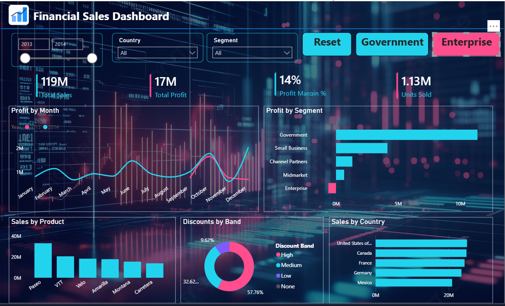

 Financial Sample – Power BI Report

 1. Overview
Interactive Power BI report analysing 700 sales transactions (Sep 2013 – Dec 2014) across 5 segments, 5 countries and 6 products.

**Headline numbers**

| Metric | Value |
|------|
| Gross Sales | 127.93M |
| Discounts | 9.21M (7.2% of gross sales) |
| Net Sales | 118.73M |
| COGS | 101.83M |
| Profit | 16.89M |
| Profit Margin | 14.2% |
| Units Sold | 1.126M |

 2. Data Import & Preprocessing
- Loaded `Financial_Sample.xlsx` (700 rows x 16 columns) into Power BI through Power Query (Get Data > Excel).
- Quality check: no duplicate rows and no blank cells. The financial columns are internally consistent (Gross Sales = Units x Sale Price, Net Sales = Gross Sales - Discounts, Profit = Net Sales - COGS). `Discount Band` contains the text "None" (53 rows), which is a valid category and not missing data.
- Cleaning steps applied:
  1. Removed the leading space from the column name `" Sales"` and renamed it `Net Sales`.
  2. Set correct data types: Date as Date, money columns as Fixed decimal number, Units Sold as Decimal number (some values are fractional), Year and Month Number as Whole number.
  3. Sorted `Month Name` by `Month Number` so months appear in calendar order.
  4. Created measures: Total Sales, Total Profit, Profit Margin % (Profit / Net Sales) and Units Sold.

 3. Report Design
A single-page interactive dashboard with a dark theme and a consistent cyan / pink colour palette.

- **Header:** logo image and report title.
- **Slicers:** Year, Country, Segment.
- **KPI cards:** Total Sales, Total Profit, Profit Margin %, Units Sold.
- **Visuals:** Profit by Month (line, split by year), Profit by Segment (bar), Sales by Product (column), Discounts by Band (donut), Sales by Country (bar).
- **Buttons and bookmarks:** three buttons linked to bookmarks: *Reset* (clears all filters), *Government* (shows only the Government segment) and *Enterprise* (shows only the Enterprise segment, to highlight its losses).
- **Images:** logo in the header and a finance-themed background image.

 4. Key Insights

**1. Government drives the business.** Government is 44% of net sales (52.5M) and 67% of profit (11.4M) with a 21.7% margin. Losing or weakening this segment would hit overall results hard.

**2. Enterprise sells a lot but loses money.** Enterprise brings 19.6M in sales (16.5%) but a total loss of -0.61M (margin -3.1%). All 58 loss-making transactions in the dataset belong to Enterprise, totalling about -0.78M. Pricing or cost structure in this segment needs review.

**3. Small Business has high volume, thin margin.** 42.4M in sales (36%) but only a 9.8% margin, well below the 14.2% average.

**4. Channel Partners are extremely profitable but tiny.** Margin of 73.1%, but only 1.8M in sales (1.5% of total). Midmarket (27.7% margin, 2.4M sales) is similar: a growth opportunity.

**5. Heavy discounting destroys margin.** Margin by discount band: None 21.9%, Low 17.9%, Medium 14.4%, High 9.1%. High discounts account for 5.3M of the 9.2M total discounts (58%) and produce the least profit per sale, while Low and Medium bands each earn more profit with fewer discounts.

**6. Product mix.** Paseo is the top product (33.0M sales, 28% of total; 4.80M profit). Carretera is lowest in profit (1.83M). Amarilla has the best margin (15.9%) and Velo the lowest (12.6%).

**7. Countries are balanced, margins are not.** Sales range only from 20.9M (Mexico) to 25.0M (USA). The USA has the highest sales but the lowest margin (12.0%), likely because of higher discounts (2.24M, the most of any country). France earns the most profit (3.78M) and Germany has the best margin (15.7%).

**8. Seasonality: strong Q4 and mid-year peaks.** In 2014, December (2.03M) and October (1.78M) were the strongest profit months, followed by June (1.47M). November 2014 dipped sharply to 0.60M. October is also the peak in 2013 (1.66M).

**Caveat:** 2013 contains only Sep–Dec, so 2013 vs 2014 totals are not directly comparable. Compare the same months or use margin %.

## 5. Recommendations
- Review Enterprise pricing and costs to stop the losses.
- Cap or tighten High discount approvals, especially in the USA.
- Grow Channel Partners and Midmarket given their strong margins.
- Plan inventory and campaigns around Q4 and June peaks; investigate the November drop.
